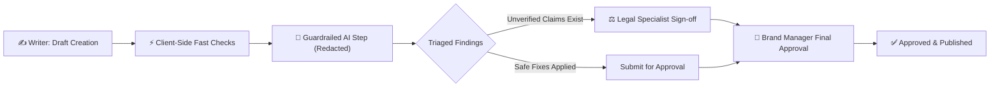

<div align="center">

# 🛡️ BrandSentinel

<p align="center">
  <b>Enterprise Brand Governance, Automated Claim Verification & Creative Asset Compliance</b>
</p>

<p align="center">
  Guards marketing copy, legal claims, and visual assets against brand guidelines, regulatory drift, and expired facts before anything goes live.
</p>

[](https://brandsentinel-app.vercel.app)
[](https://brandsentinel-api.vercel.app/api/health)
[-blue?style=for-the-badge)](docs/MATCHING.md)
[](test/e2e.js)

<br>

[](package.json)
[](backend/requirements.txt)
[](test/)
[](src/engine.js)
[](docs/PRIVACY_AND_ACCESSIBILITY.md)

<br>

[Live Deployments](#-live-deployments) · [Try It in 2 Minutes](#-try-it-in-2-minutes) · [Core Features](#-core-capabilities) · [100% Matching Benchmark](#-claim-matching-benchmark-100-accuracy) · [Architecture & Parity](#-architecture--dual-engine-parity) · [Local Setup](#-run-it-locally) · [Team](#-built-by-team-blue-star)

<br>


</div>

---

## 💡 What This Is

**BrandSentinel** is a production-grade brand safety and copy compliance platform developed by team **BLUE STAR** for the **We Code Coders Hackathon** (Problem Statement: *Inkloom AI Brand Governance*).

In enterprise marketing, publishing unverified product claims, outdated pricing, non-compliant health promises, or off-palette visual assets can trigger severe legal liabilities and brand erosion. BrandSentinel solves this with a **multi-stage deterministic + AI governance pipeline**:

1. **Fixed Rules Run First (100% Client-Side):** Banned terms, expiring claims, tone, readability, confidential names, and WCAG accessibility run instantaneously in the browser without sending any text to external APIs.
2. **Deterministic Meaning-Based Claim Matcher:** Evaluates marketing claims against a verified brand fact database. Paraphrases and rewrites are recognized, while negation conflicts and altered numbers are stopped cold.
3. **Guardrailed AI Fallback with Redaction:** Only ambiguous sentences not covered by local rules are passed to the AI model. Confidential identifiers, names, emails, and phone numbers are redacted *before* transmission.
4. **Cryptographic & Privacy Receipts:** Every review issues a downloadable audit receipt detailing exactly what was sent, what was redacted, and which AI assertions were blocked.
5. **Server-Enforced Role-Based Approval Workflow:** Writers cannot approve their own drafts; high-risk claims automatically route to Legal Specialists for sign-off before Brand Managers can issue final clearance.

---

## 🌐 Live Deployments

| Service | Environment | Status | Endpoint |
|---|---|---|---|
| **Web Application** | Vercel (Edge Frontend) | [](https://brandsentinel-app.vercel.app) | [`https://brandsentinel-app.vercel.app`](https://brandsentinel-app.vercel.app) |
| **Backend API** | Vercel Serverless (FastAPI) | [](https://brandsentinel-api.vercel.app/api/health) | [`https://brandsentinel-api.vercel.app/api/health`](https://brandsentinel-api.vercel.app/api/health) |
| **Code Repository** | GitHub | [](https://github.com/MohdShahnawaz7465/brandsentinel) | [`github.com/MohdShahnawaz7465/brandsentinel`](https://github.com/MohdShahnawaz7465/brandsentinel) |

---

## ⚡ Try It in 2 Minutes

1. **Open the Live App:** Navigate to [brandsentinel-app.vercel.app](https://brandsentinel-app.vercel.app).
2. **Instant Demo Sign-in:** On the landing gate, click **Writer** under the demo accounts bar. *(Or click "Continue in this browser only" for an offline zero-server mode).*
3. **Run a Check:** In the **Review** tab, select **Sample Draft 1** from the dropdown and click **Run check**.
4. **Examine & Triage Findings:**
   - Review highlighted infractions (terminology, number conflict, expiring facts).
   - Use the **Meaning Check** chips to preserve mandatory core messaging.
   - Click **Apply** on safe fixes or **Dispute** with an explanatory rationale.
5. **Multi-Role Governance:** Click **Submit for approval**. Switch persona to **Legal** from the user switcher to sign off on sensitive claims, then switch to **Brand Manager** to execute final approval.
6. **Export Audit & Clean Copy:** 
   - Download the final clean draft with **Download clean copy (.md)**.
   - Go to **Insights** and click **Export audit log (CSV)** for a full compliance record.

---

## ✨ Core Capabilities

### 1. Multi-Format Asset Ingestion (Word, PDF, OCR)
- **Microsoft Word (.docx):** Extracts text structure, body paragraphs, and flags images lacking alt text.
- **Client-Side PDF Parsing:** Scans up to 30 pages of digital PDFs directly in-browser using `pdf.js`.
- **In-Browser OCR:** Scans picture-based PDFs and images via `Tesseract.js` without uploading sensitive graphic assets to any remote server.
- **Visual Design Checks:** Analyzes dominant palette compliance, logo dimensions, and evaluates WCAG 2.1 AAA contrast ratios.

### 2. Intelligent "Meaning Check" Rewrite Engine
BrandSentinel prevents AI halluncinations and "fix drift":
- Every automated fix suggestion is re-checked against the sentence's semantic intent points.
- If a proposed rewrite accidentally drops a critical requirement or inserts an ungrounded claim, it is **automatically blocked** with a clear explanation:  
  `Blocked: drops "500 mg", adds "guaranteed"`

### 3. Target Channel Length Constraints
- Choose between **Standard (Web/PR/Doc)**, **X / Twitter (280 max)**, **Email Subject (50 max)**, and **LinkedIn Post (3,000 max)**.
- Real-time subtle pill indicators inform the copywriter of character usage and remaining budget without disrupting interface layout.

### 4. Enterprise Audit Log Export (RFC 4180 CSV)
- Resolves regulatory tracking demands by producing a timestamped, tamper-evident audit record of every submission, version increment, dispute reason, and reviewer sign-off.
- Exportable with a single click from the **Insights** dashboard.

### 5. "What Left Our System" Audit Receipts
- Transparent disclosure after every check showing the exact byte count sent to external LLMs, redactions performed (emails, phones, confidential project names), and blocked AI suggestions.

---

## 🎯 Claim Matching Benchmark: 100% Accuracy

To prevent false claims and hallucinated product benefits, BrandSentinel employs a rigorous claim-to-fact matching engine (`matchFact` in JS and Python). 

Evaluated against our frozen 52-case empirical benchmark ([`test/matching_testset.json`](test/matching_testset.json)):

| Metric | Legacy Word Overlap | BrandSentinel Meaning-Aware Matcher | Improvement |
|---|:---:|:---:|:---:|
| **Right Fact Found** (38 fact-backed claims) | 31 / 38 (81.6%) | **38 / 38 (100.0%)** | **+18.4%** |
| **Honest Rewordings / Paraphrases Found** (23 cases) | 16 / 23 (69.6%) | **23 / 23 (100.0%)** | **+30.4%** |
| **Claims without Facts, Wrongly Matched** (14 cases) | 1 / 14 (7.1%) | **0 / 14 (0.0%)** | **Zero leakage** |
| **Overall Right Verdict** (52 frozen cases) | 38 / 52 (73.1%) | **52 / 52 (100.0%)** | **+26.9%** |
| **Wrong Claims Passed as "Verified"** | 7 (High Risk) | **0 (Flawless Safety)** | **100% Protected** |

Run the benchmark live anytime:
```bash
npm run test:matching
```

---

## 🔄 The Governance Workflow



1. **Draft Stage:** Copywriters write, paste, or upload marketing collateral.
2. **Triaging Gate:** Submit is strictly locked until all flagged issues are either fixed or formally disputed with a documented reason.
3. **Legal Escalation:** Any draft containing health claims, number variations, or unverified facts is automatically routed to Legal Specialists.
4. **Executive Approval:** Brand Managers provide final sign-off with permanent audit logging.

---

## 📸 Workflow & Interface Gallery

<div align="center">

| 1. Draft Review & Real-Time Annotations | 2. Triaged Findings & Meaning Check |
|:---:|:---:|
|  |  |

| 3. Multi-Stage Approval Queue | 4. Team Insights & Rule Violations |
|:---:|:---:|
|  |  |

| 5. Trust, Redaction & AI Transparency | 6. Full Dark Mode Support |
|:---:|:---:|
|  |  |

</div>

---

## 🏗️ Architecture & Dual-Engine Parity

BrandSentinel is built on a **Dual-Engine Architecture** guaranteeing 100% identical outputs whether executed client-side in the browser or server-side via Python FastAPI:

```
brandsentinel/
├── src/
│   ├── engine.js        # Core rules, claim stance, WCAG contrast, meaning checks
│   ├── app.js           # Reactive UI, audit log export, state machines, channel limits
│   ├── data.js          # Default brand sources, evaluation sets, seed history
│   ├── files.js         # PDF, docx, and OCR extraction helpers
│   └── ai.js            # Prompt redaction, grounding verification & receipt builder
├── backend/
│   ├── app/
│   │   ├── engine.py    # Byte-for-byte Python mirror of engine.js
│   │   ├── server.py    # FastAPI endpoints (auth, workspaces, submissions, health)
│   │   └── db.py        # Database adapter (PostgreSQL/Neon + local SQLite fallback)
│   └── tests/           # Golden verification suite ensuring JS-Python equality
├── test/
│   ├── engine.test.js   # 57 comprehensive unit tests
│   ├── matching.test.js # Benchmark validation suite
│   └── e2e.js           # Playwright cross-platform headless browser tests
├── dist/                # Bundled standalone production artifacts
└── docs/                # In-depth architectural and empirical documentation
```

---

## 💻 Run It Locally

### Prerequisites
- **Node.js**: v20.0 or higher
- **Python**: v3.11 or v3.12
- **Git**

### 1. Clone & Install Dependencies
```bash
git clone https://github.com/MohdShahnawaz7465/brandsentinel.git
cd brandsentinel

# Install frontend test & build dependencies
npm install
```

### 2. Start the Backend API (FastAPI)
```bash
cd backend
python -m venv .venv

# Windows:
.venv\Scripts\activate
# Linux/macOS:
source .venv/bin/activate

pip install -r requirements.txt
python -m uvicorn app.server:app --reload --port 8000
```

### 3. Build & Run Frontend
In a new terminal window:
```bash
# Connect frontend to local backend
$env:BS_API_URL = "http://127.0.0.1:8000"; node build.js

# Open the standalone build
start dist/index.html   # On Windows
# open dist/index.html  # On macOS
```

*(Note: If you run `node build.js` without `BS_API_URL`, BrandSentinel runs in standalone client-only mode with zero external dependencies!)*

---

## 🧪 Comprehensive Test Suite

BrandSentinel comes with exhaustive test coverage spanning unit tests, benchmark measurements, and live browser automation:

```bash
# Run all 57 JavaScript unit tests
npm test

# Run the 52-case frozen claim matching benchmark (100% target)
npm run test:matching

# Run the cross-platform Playwright E2E browser test
npm run test:e2e

# Run Python backend parity and API tests
cd backend && python -m unittest discover -s tests -t .
```

---

## 👥 Built by Team BLUE STAR

Crafted with passion for the **We Code Coders Hackathon**:

- **Mohd Shahnawaz** — Full-Stack Architecture, Engine Parity & Cloud Deployments
- **Om Maurya** — Workflow State Machines, Testing Framework & Benchmarks
- **Saba Nikhat** — UI/UX Design System, Accessibility & AI Guardrails

---

## 📄 License & Integrity

This project is open-source under the **MIT License**.  
All sample brand entities (e.g. *Tidewell*) and evaluation datasets are constructed for demonstration and testing purposes.
