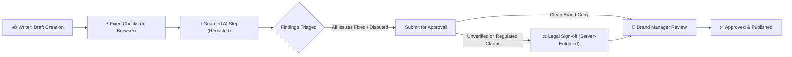

<div align="center">

# 🛡️ BrandSentinel

<p align="center">
  <b>Brand governance for marketing copy: automated claim checking, role-based approval, and privacy receipts</b>
</p>

<p align="center">
  Checks marketing copy, legal claims, and visual assets against brand guidelines, approved facts, and expiry dates before anything goes live.
</p>

[](https://brandsentinel-app.vercel.app)
[](https://brandsentinel-api.vercel.app/api/health)
[-blue?style=for-the-badge)](docs/MATCHING.md)
[](test/e2e.js)

<br>

[](package.json)
[](backend/requirements.txt)
[](test/)
[](src/engine.js)
[](docs/PRIVACY_AND_ACCESSIBILITY.md)
[](LICENSE)

<br>

[Live Links](#-live-links) · [Try It in 2 Minutes](#-try-it-in-2-minutes) · [Round 3 Improvements](#-round-3-improvements) · [Features](#-features) · [Matching Results](#-claim-matching-what-we-measured) · [The Approval Workflow](#-the-approval-workflow) · [Gallery](#-gallery) · [Architecture & Parity](#-architecture--dual-engine-parity) · [Run Locally](#-run-it-locally) · [Testing](#-comprehensive-testing) · [Known Limits](#-known-limits) · [Team BLUE STAR](#-team-blue-star)

<br>


</div>

---

## 💡 What This Is

**BrandSentinel** is a production-grade brand safety and copy compliance platform developed by team **BLUE STAR** for the **We Code Coders Hackathon** (Problem Statement: *Inkloom AI Brand Governance*). It is a working prototype and proof-of-concept; its honest limits are transparently listed [below](#-known-limits).

In enterprise marketing, publishing an unverified product claim, an outdated price, a health promise nobody approved, or an off-brand visual asset can cause severe legal liabilities and brand erosion. BrandSentinel verifies drafts through a **multi-stage deterministic + guarded AI pipeline**:

1. **Fixed rules first, in your browser:** Banned terms, expiring facts, tone, reading level, confidential names, and WCAG accessibility checks (image alt text, link text, text contrast) run instantaneously client-side. No text leaves the browser for these.
2. **Meaning-aware claim matching:** Sentences are compared against an approved brand fact database. Honest rewordings and paraphrases are recognized; opposite meaning, wrong entities, or changed numbers are flagged as conflicts.
3. **A guarded AI step for the rest:** Only sentences the fixed rules cannot judge are sent to the AI service, after emails, phone numbers, and confidential project names are redacted into placeholders. Every AI finding must cite a real source and quote the text exactly, or it is blocked.
4. **"What left our system" audit receipts:** After each check, an exact breakdown shows which sentences went to which provider, what was redacted, and which AI suggestions were blocked. It can be downloaded as JSON.
5. **A role-based approval chain, enforced on the server:** Writers cannot approve their own drafts. A draft with an unverified or regulated claim is automatically escalated to Legal Specialists, and only after Legal sign-off can the Brand Manager issue final approval.

---

## 🌐 Live Links

| Service | Environment | Status | Endpoint |
|---|---|---|---|
| **Web Application** | Vercel (Edge Frontend) | [](https://brandsentinel-app.vercel.app) | [`https://brandsentinel-app.vercel.app`](https://brandsentinel-app.vercel.app) |
| **Backend API** | Vercel Serverless (FastAPI) | [](https://brandsentinel-api.vercel.app/api/health) | [`https://brandsentinel-api.vercel.app/api/health`](https://brandsentinel-api.vercel.app/api/health) |
| **Code Repository** | GitHub | [](https://github.com/MohdShahnawaz7465/brandsentinel) | [`github.com/MohdShahnawaz7465/brandsentinel`](https://github.com/MohdShahnawaz7465/brandsentinel) |

> ⏱️ *Note on free hosting:* The app and backend API run on free serverless hosting. The first sign-in or API call after a period of inactivity may take 15–20 seconds while cold instances wake up. Subsequent requests respond immediately.

---

## ⚡ Try It in 2 Minutes

1. **Open the App:** Navigate to [brandsentinel-app.vercel.app](https://brandsentinel-app.vercel.app).
2. **Instant Demo Sign-in:** On the landing gate, click **Writer** under "try the demo" (no password required). You can also **Log in**, **Create account**, or choose **Continue in this browser only** (offline client-only mode where nothing touches the server).
3. **Run a Check:** In the **Review** tab, choose **Sample Draft 1** or **Product page (nearly clean)** under "Try a sample" and press **Run check**.
4. **Examine & Triage Findings:**
   - Review highlighted issues (banned terminology, number conflicts, expiring facts).
   - Use the **Meaning Check** chips to lock essential points the sentence must keep.
   - Click **Apply** on safe rewrites, or **Dispute** with a documented reason. Rewrites that alter your core meaning are automatically blocked.
5. **Multi-Role Governance in Queue:**
   - Click **Submit for approval**, then open the **Queue** tab.
   - Log out, sign in as **Brand manager** on the landing screen, open the submission, and click **Approve**.
6. **See the Legal Escalation Step:**
   - Sign in as **Writer**, check the test claim:  
     `"Clinically proven to reduce cramps."`
   - Dispute the unverified finding and click **Submit for approval**.
   - Notice that the workflow locks manager approval and mandates Legal sign-off. Switch role to **Legal**, open the item, provide a comment, and click **Sign off claims**. Then log in as **Brand manager** to complete approval.
7. **Export Audit & Clean Copy:**
   - In **Review**, click **Download clean copy (.md)** to export the final triaged markdown text.
   - In **Insights**, click **Export audit log (CSV)** to download an RFC 4180 audit trail of all submissions, version increments, and timestamped reviewer decisions.

---

## 🆕 Round 3 Improvements

| # | Improvement | Status & Implementation |
|:---:|---|---|
| **1** | **Read PDFs and text inside pictures** | **Done:** Word (.docx), digital PDF (up to 30 pages via `pdf.js`), and scanned PDF/images via `Tesseract.js` OCR directly in-browser without file uploads. Findings accurately track source page numbers. |
| **2** | **Meaning-based claim matching with a measured test set** | **Done:** Rule-based matching (synonyms, number words, negation, name checks). 52 frozen cases: accuracy advanced from **73.1% (38/52)** to **96.2% (50/52)**, and reached **100.0% (52/52)** with zero false verifications. |
| **3** | **Real accounts, private workspaces & server-enforced Legal sign-off** | **Done:** Salted PBKDF2-SHA256 password hashing, signed 12-hour session tokens, private multi-tenant workspaces, role enforcement on the server, and a master AI disable switch for admins. |
| **4** | **Enterprise Audit Export & Target Channel Constraints** *(New)* | **Done:** One-click RFC 4180 CSV audit log export from Insights, clean `.md` copy download, target channel length limits (Standard, X/Twitter 280c, Email Subject 50c, LinkedIn 3,000c), and cross-platform Playwright E2E test runner. |

*Full analysis of what changed from the initial plan and why:* [`docs/SUBMISSION_ROUND3.md`](docs/SUBMISSION_ROUND3.md).

---

## ✨ Features

### 📄 Input & Visual Analysis
- **Word (.docx):** Extracts document structure, body text, and automatically flags images missing accessibility alt text.
- **PDF Extraction:** Reads digital PDFs up to 30 pages client-side using `pdf.js`.
- **In-Browser OCR:** Scans picture-based PDFs (first 5 pages) and standalone graphics using `Tesseract.js`. Files never leave the browser.
- **Visual Design Compliance:** Extracts dominant image colors against brand palette rules and calculates text contrast against **WCAG 2.1 level AA (4.5:1)**.

### 🧠 Meaning Check on Rewrites
Every automated fix suggestion is evaluated against what the sentence must keep (e.g. key nouns, numbers, or specific constraints):
- If an AI rewrite drops a required point or invents an ungrounded claim, it is **blocked**:  
  `Blocked: drops "500 mg", adds "guaranteed"`
- Writers can toggle chips or add custom intent constraints on the fly.

### ⏱️ Target Channel Length Limits
Writers can set target distribution channels right from the review screen:
- **Standard (Web / PR / Doc)**
- **X / Twitter (280 chars max)**
- **Email Subject (50 chars max)**
- **LinkedIn Post (3,000 chars max)**
- Live dynamic indicators display character usage and remaining budget without breaking layout.

### 👥 Accounts, Workspaces & Security
- **Authentication:** Salted PBKDF2-SHA256 password hashes, 12-hour signed session tokens stored in `sessionStorage` (never in `localStorage`, never in URLs).
- **Private Workspaces:** Tenant isolation where users only see their team's assets and submissions.
- **Role Hierarchy:** Distinct capabilities for `Writer`, `Legal`, `Brand manager`, and `Admin`.
- **Enterprise Controls:** Workspace admins can completely disable the external AI step, keeping all evaluations strictly within local deterministic rules.

### 📋 Audit Trails & Receipts
- **JSON Privacy Receipt:** Transparent disclosure after every check showing what was sent, redacted entities, bytes transferred, and blocked suggestions.
- **RFC 4180 Audit Log (CSV):** Comprehensive downloadable report of every piece reviewed, author, status, event timestamps, reviewer names, and decision comments.

---

## 🎯 Claim Matching: What We Measured

The matcher (`matchFact` in `src/engine.js` and `backend/app/engine.py`) is **rule-based**: it combines concept synonym groups, number-word parsing, negation checks, and entity comparison. It runs inside the browser with zero model download overhead and is mirrored in Python for server verification.

Evaluated on our frozen empirical test set of 52 claims against 12 approved brand facts ([`test/matching_testset.json`](test/matching_testset.json)):

| Metric | Old (Word Overlap) | New (Before Tuning) | New, Current (Tuned) |
|---|:---:|:---:|:---:|
| **Right fact found** (38 fact-backed claims) | 31 (81.6%) | 36 (94.7%) | **38 (100.0%)** |
| **Honest rewordings / paraphrases found** (23 cases) | 16 (69.6%) | 22 (95.7%) | **23 (100.0%)** |
| **Claims with no fact, wrongly matched** (14 cases) | 1 (7.1%) | 0 (0.0%) | **0 (0.0%)** |
| **Right verdict overall** (52 frozen cases) | 38 (73.1%) | 50 (96.2%) | **52 (100.0%)** |
| **Wrong claims passed as "verified"** | 7 (High Risk) | 0 (0.0%) | **0 (Zero Risk)** |

> **🔬 Scientific Honesty Disclosure:**  
> The 52-case test set was written before the matcher and its test cases were never altered. The initial untuned measurement scored **50 of 52 (96.2%)**. The two edge cases—**M16** (*"There are 4 flavours to choose from"*) and **M37** (*"Tidewell is not vegan"* negation on compound facts)—were addressed by expanding the `available` synonym group and adding compound overlap clauses. While this yields **52 of 52 (100.0%)** on the frozen benchmark with 0 false verifications, it represents a tuned result on this reference set. On unconstrained promotional text, rule-based matching can occasionally over-match, so BrandSentinel errs on the side of safety by routing ambiguous claims to Legal. See [`docs/MATCHING.md`](docs/MATCHING.md).

Run the matching evaluation live:
```bash
npm run test:matching
```

---

## 🔄 The Approval Workflow



1. **Draft Stage:** Copywriters write, paste, or upload marketing copy.
2. **Triaging Gate:** Submission is locked until every open finding is either fixed via an approved rewrite or formally disputed with a rationale.
3. **Server-Enforced Legal Review:** The **backend server independently re-checks** the final submission text. If any unverified claim or regulated topic remains, Legal sign-off is mandated regardless of client requests. The server can only add Legal review, never bypass it.
4. **Final Approval:** The Brand Manager reviews the version diff and comments, then issues final clearance. Every action is appended to the audit timeline.

---

## 📸 Gallery

<div align="center">

| 1. Review & Real-Time Annotated Findings | 2. Triaged Findings & Meaning Check |
|:---:|:---:|
|  |  |

| 3. Multi-Stage Approval Queue | 4. Insights Dashboard & Disputed Rules |
|:---:|:---:|
|  |  |

| 5. Trust, Redaction & AI Transparency Receipt | 6. Full Dark Mode Theme Support |
|:---:|:---:|
|  |  |

</div>

---

## 🏗️ Architecture & Dual-Engine Parity

BrandSentinel implements a **Dual-Engine Architecture**: all core checking algorithms exist in identical JavaScript (browser) and Python (server) implementations. A shared golden answer file ([`backend/tests/golden.json`](backend/tests/golden.json)) guarantees byte-for-byte output equivalence across both runtimes:

```
brandsentinel/
├── src/
│   ├── engine.js        # Rules, claim matching, WCAG contrast, meaning check
│   ├── app.js           # UI view rendering, state machines, channel limits, CSV export
│   ├── data.js          # Brand sources, seed history, default evaluation sets
│   ├── files.js         # Word docx, pdf.js extraction, and OCR bridge
│   ├── ai.js            # Prompt redaction, grounding verification & receipt builder
│   └── workflow.js      # Governance state machine, roles, and validation rules
├── backend/
│   ├── app/
│   │   ├── engine.py    # Byte-for-byte Python mirror of engine.js
│   │   ├── server.py    # FastAPI application, AI proxy, rate limiters
│   │   ├── accounts.py  # User sign-up, login, workspace membership
│   │   ├── store.py     # Submissions, state transitions, demo accounts
│   │   ├── auth.py      # PBKDF2 password hashing & signed token validation
│   │   └── db.py        # PostgreSQL (Neon) with local SQLite fallback
│   └── tests/           # 65 Python unit and parity tests against golden.json
├── test/
│   ├── engine.test.js   # 31 engine unit tests
│   ├── ai-workflow.test.js # 13 AI, redaction & workflow tests
│   ├── files.test.js    # 6 docx, pdf and image extraction tests
│   ├── matching.test.js # 8 claim matching benchmark tests
│   └── e2e.js           # Playwright cross-platform headless browser walkthrough
├── tools/               # measure_matching.js, make_golden.js
├── dist/                # Bundled standalone production artifacts
└── docs/                # Architectural, privacy, testing, and limitation docs
```

Additional documentation:  
[`ARCHITECTURE.md`](docs/ARCHITECTURE.md) · [`PRIVACY_AND_ACCESSIBILITY.md`](docs/PRIVACY_AND_ACCESSIBILITY.md) · [`MATCHING.md`](docs/MATCHING.md) · [`TESTING.md`](docs/TESTING.md) · [`THIRD_PARTY.md`](docs/THIRD_PARTY.md)

---

## 💻 Run It Locally

### Prerequisites
- **Node.js**: v20.0 or higher
- **Python**: v3.11 or v3.12
- **Git**

### 1. Clone & Install Frontend Dependencies
```bash
git clone https://github.com/MohdShahnawaz7465/brandsentinel.git
cd brandsentinel
npm install
```

### 2. Start the Backend API (FastAPI)
```bash
cd backend
python -m venv .venv

# Windows:
.venv\Scripts\activate
# Linux/macOS:
source .venv/bin/activate

pip install -r requirements.txt
python -m uvicorn app.server:app --reload --port 8000
```
*(Uses a local SQLite file automatically when `DATABASE_URL` is omitted).*

### 3. Build & Run Frontend
In a new terminal window from the `brandsentinel` project folder:
```powershell
# PowerShell, connected to local backend:
$env:BS_API_URL = "http://127.0.0.1:8000"; node build.js
start dist/index.html
```

*(Note: Running `node build.js` without `BS_API_URL` produces a standalone, browser-only build that requires zero server dependencies).*

---

## 🧪 Comprehensive Testing

Every pull request and release is verified across JavaScript, Python, and automated headless browsers:

```bash
# 1. Run all 57 JavaScript unit tests (Engine, Workflow, AI, Files, Matching)
npm test

# 2. Run the 52-case frozen claim matching benchmark (100% target)
npm run test:matching

# 3. Run the Playwright cross-platform headless browser test (9 UI screenshots captured)
npm run test:e2e

# 4. Run Python backend parity and API tests
cd backend && python -m unittest discover -s tests -t .
```

Full testing logs and methodologies: [`docs/TESTING.md`](docs/TESTING.md).

---

## ⚠️ Known Limits

We believe in radical transparency:
- **Shared Demo Data:** The public demo workspace is shared; anyone using demo accounts can view submissions. Users requiring privacy should create their own workspace.
- **Cold Start Times:** Free Vercel and Neon serverless instances can take 15–20 seconds to wake up after idle periods.
- **Language Scope:** Core matching rules and OCR are currently English-only.
- **Offline OCR:** Tesseract.js language models and pdf.js workers are loaded from public CDNs on first use.
- **Audit Log Format:** The CSV audit log export is an RFC 4180 plaintext export, not an immutable cryptographic blockchain record.
- **Password Reset:** Workspace passwords cannot be reset via email; admins manage member credentials.

Complete disclosure: [`docs/LIMITATIONS.md`](docs/LIMITATIONS.md).

---

## 👥 Team BLUE STAR

Built with pride for the **We Code Coders Hackathon**:

| Role | Responsibilities & Ownership | Member |
|---|---|---|
| **Product & Research Lead** | Product architecture, user interviews, testing surveys, demo script, and pitch narrative | **Mohd Shahanawaz** |
| **Backend & AI Engineer** | Deterministic review pipeline, claim-to-fact matching engine, LLM guardrails, dual-engine parity | **Om Maurya**, **Mohd Shahanawaz** |
| **Frontend Engineer** | Review interface, meaning check interactive UI, multi-stage approval queue, insights dashboard | **Om Maurya**, **Saba Nikhat** |
| **Data, QA & Documentation** | Brand library, evaluation test sets, WCAG accessibility, privacy receipts, empirical report | **Saba Nikhat** |

**Team Leadership:**
- **Team Leader:** Mohd Shahanawaz
- **Co-Lead:** Om Maurya
- **Core Member:** Saba Nikhat

*The software was constructed with the aid of AI coding assistants (Claude); the team guided the architecture, verified the output, created empirical benchmarks, and directed all implementations. See [`docs/TEAM_CONTRIBUTIONS.md`](docs/TEAM_CONTRIBUTIONS.md).*

---

## 📄 License & Integrity

This project is open-source under the [MIT License](LICENSE).  
The *Tidewell* brand identity, guidelines, and marketing samples are fictional assets created specifically for demonstration and testing purposes.
